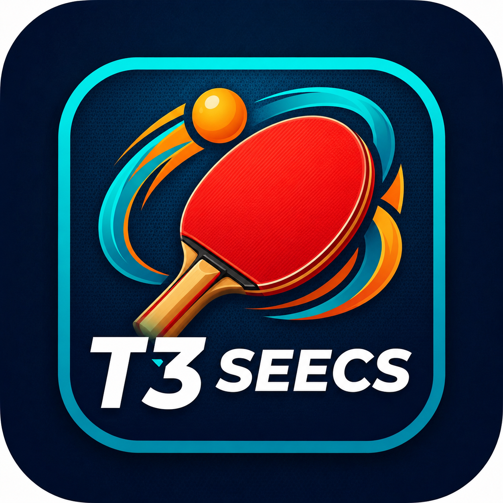

# Sportron

**Organize pickup sports, find matches, and track your game.**

Sportron is a multi-sport community app for players who want to actually play. Join community, find or create a pickup session, record your matches, and keep your stats.

Looking for a game? **Sportron** helps you find one. Coming in table tennis, badminton, tennis, squash, pickleball, football, cricket, volleyball, handball, and basketball.

---

## Why Sportron?

Sportron was built for the community that loves to play — students, teachers, and players who want a reliable way to find partners and keep score.

- **Play more** — Find open pickup sessions near you and jump in.
- **Track every match** — Record scores, get results approved by your opponent, and watch your record build.
- **Stay in your lane** — Join communities by sport, from table tennis to football.
- **Never miss a game** — Get pinged when there's live in your community, and get notified when plans change.

---

## Features

### Communities
- Start or join communities organized around a specific sport.
- Public (join anytime) or restricted (request to join, admin approves).
- Optional organization (university/club) and location/city so communities with the same name are easy to tell apart; two users can share a name, but one user can't create a duplicate.
- Discover communities by sport or search by name.
- Cards show "created by", organization, sport, and visibility.
- Community cover photos, member lists, and admin tools.

### Match Tracking
- Record matches inside a community — singles or doubles.
- Team sports? Add your team names and opponent captain.
- Scores with +/- stepper and direct entry.
- Opponent approval: your opponent confirms or challenges the result.
- Likes, comments, win/loss records.

### Find a Match (Sessions)
- Create pickup sessions with sport, location, time, and capacity.
- Sessions expire automatically if no one joins.
- Apply, accept, reject, or leave — just like scheduling a real game.

### Pings
- Ping your whole community: *"Playing tonight, anyone in?"*
- Members reply **Coming** or **Busy**, live.

### Notifications
- Real-time activity. Get notified for session applications, join requests, match approvals, pings, and invites.
- Push notifications delivered straight to your device; each type is customizable in Settings.

---

## Privacy First

We take your data seriously.

- **No GPS tracking** — the app uses text locations you type yourself; we never track your location.
- **Google sign-in only** — we never store your password.
- **No ads, no selling data.**
- In-app **Delete Account** — erase your data whenever you want.

Full details: [Privacy Policy](PRIVACY_POLICY.md)

---

## How to Use

1. **Sign in** with your Google account — no separate auth needed.
2. **Complete your profile** — username, bio, role (student/teacher), photo.
3. **Explore communities** via the Communities tab or Discover.
4. **Join a community** or **create a community** (you must be a member to record matches).
5. **Record a match** from within a community so your opponent can approve it.
6. **Find a Match** tab → create or apply to a pickup session.
7. Respond to **activity & invites** in the **Settings** → Notifications for what you want to hear.

---

## Available On

- [Google Play](https://play.google.com) – *Android (coming soon)*
- [App Store]() –*iOS (coming soon)*

---

## Frequently Asked Questions

### Is Sportron free?
Yes — Sportron is free to download and use.

### Do I need an account?
You sign in with Google. A profile is created the first time you sign in.

### What sports are supported?
Table tennis, badminton, tennis, squash, pickleball, football, cricket, volleyball, handball, and basketball — plus a generic "Other".

### Can I delete my data?
Yes. Go to Profile → Settings → **Delete Account** to permanently remove your data.

### Who develops Sportron?
Sportron is developed by **Muhammad Murtaza**, based in Lahore, Pakistan.

---

## Contact

For support, questions, or feedback:

- **Email:** [murtazabaig335@gmail.com](mailto:murtazabaig335@gmail.com)
- **Privacy Policy:** [PRIVACY_POLICY.md](PRIVACY_POLICY.md)

---

© 2026 Muhammad Murtaza. All Rights Reserved.

Sportron is provided "as is" without warranty.

